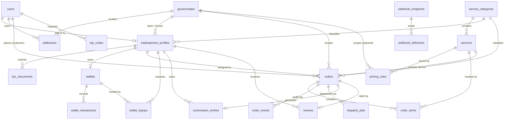

# Data Model — Entity Relationship Diagram

All monetary columns are **integer Yemeni Rial (YER)** — YER has no circulating subunit,
so no minor-unit scaling is used. Amounts are always non-negative in the ledger; the
`direction` column (`credit` / `debit`) carries the sign.



## Tables

### Identity & geo
| Table | Key columns | Notes |
|---|---|---|
| `users` | `id`, `phone` (unique), `role`, `status`, `preferred_locale`, `password?` | Phone is the identity. `password` only for `admin`/`dispatcher`. Soft-deletes. |
| `governorates` | `id`, `code` (unique), `name_ar/en`, `dispatch_multiplier` | 22 Yemeni governorates. Multiplier feeds the estimator. |
| `addresses` | `id`, `user_id?`, `governorate_id`, `district`, `directions`, `lat/lng` | Guest bookings create an ad-hoc address (`user_id` null). |

### Catalog & pricing
| Table | Key columns | Notes |
|---|---|---|
| `service_categories` | `id`, `slug`, `name_ar/en`, `icon`, `accent_color`, `requires_kyc` | |
| `services` | `id`, `service_category_id`, `pricing_model`, `base_price`, `hourly_rate`, `unit_price`, `callout_fee` | `pricing_model ∈ {fixed, hourly, per_unit, quote}`. |
| `pricing_rules` | `id`, `service_id`, `governorate_id?`, `rule_type`, `value`, `conditions` (json) | Layered overrides: `multiplier` / `flat_add` / `flat_override`, ordered by `priority`. |

### Tradesperson & trust
| Table | Key columns | Notes |
|---|---|---|
| `tradesperson_profiles` | `id`, `user_id` (unique), `primary_category_id`, `base_governorate_id`, `kyc_status`, `badges` (json), `rating_avg`, `completed_orders` | `kyc_status ∈ {unverified, pending, in_review, verified, rejected}`. |
| `kyc_documents` | `id`, `tradesperson_profile_id`, `type`, `disk`='kyc', `path`, `review_status` | Private disk, streamed through a gated controller only. |

### Orders
| Table | Key columns | Notes |
|---|---|---|
| `orders` | `id`, `reference` (unique, `YS-XXXXXX`), `customer_id?`, `service_id`, `governorate_id`, `tradesperson_profile_id?`, `status`, `urgency`, price snapshot columns, `commission_percent/amount`, `payment_method` | Immutable price snapshot + `price_breakdown` json. Soft-deletes. |
| `order_items` | `id`, `order_id`, `service_id`, `quantity`, `unit_price`, `line_total` | |
| `order_events` | `id`, `order_id`, `type`, `from_status`, `to_status`, `actor_id?` | Append-only. |
| `dispatch_jobs` | `id`, `order_id`, `tradesperson_profile_id?`, `mode`, `status`, `wa_deeplink`, `payload` (json), `geo_tags` (json), `n8n_execution_id` | One row per dispatch attempt. |
| `reviews` | `id`, `order_id` (unique), `rating` 1-5, `comment` | |

### Wallet ledger
| Table | Key columns | Notes |
|---|---|---|
| `wallets` | `id`, `owner_type/id` (nullable → system wallets), `type`, `available_balance`, `pending_balance`, `commission_due`, `lifetime_*` | `type ∈ {tradesperson, platform_escrow, platform_revenue}`. Unique on `(owner_type, owner_id, type)`. |
| `wallet_transactions` | `id`, `group_uuid`, `wallet_id`, `direction`, `bucket`, `amount`, `balance_after`, `type`, `reference_type/id` | Double-entry: every posting writes ≥ 2 rows sharing `group_uuid`, net zero. |
| `wallet_topups` | `id`, `wallet_id`, `amount`, `method`, `reference_code`, `proof_path`, `status`, `auto_matched_via` | `status ∈ {pending, confirmed, rejected}`. |
| `commission_entries` | `id`, `order_id`, `commission_percent/amount`, `settlement`, `status` | Per-order audit, independent of the ledger. |

### Integrations
| Table | Key columns | Notes |
|---|---|---|
| `otp_codes` | `id`, `phone`, `code_hash`, `channel`, `session_token`, `expires_at`, `attempts` | Codes hashed with bcrypt; never stored in clear. Prunable. |
| `webhook_endpoints` | `id`, `name`, `url`, `secret`, `events` (json), `failure_count`, `disabled_at?` | Auto-disabled after 20 consecutive failures. |
| `webhook_deliveries` | `id`, `webhook_endpoint_id`, `event_id`, `event_type`, `payload`, `attempt`, `status`, `next_retry_at` | Exponential backoff, max 5 attempts, then `dead`. |
| `inbound_events` | `id`, `source`, `signature_status`, `payload`, `handler`, `status` | Receipts for WhatsApp / n8n / SMS callbacks. |
```
